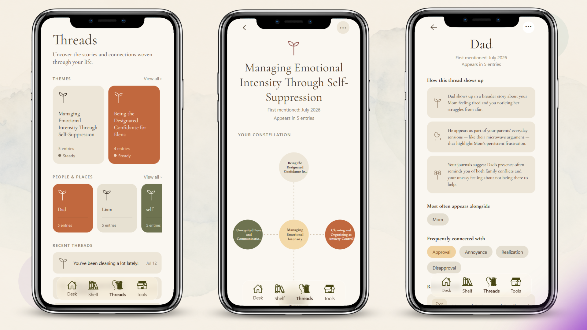

# MindLine

**A journal that talks back.**

MindLine is an interactive journaling app that learns more about you with every entry. Each entry is broken down into the people, places, things and actions in your life, scored for emotion and sentiment, and stored in a personal knowledge graph. AI agents then read that graph to show you how you've been doing emotionally, how the parts of your life connect, and which patterns keep coming back.

<p align="center">
  <!-- Replace with your image -->
  
</p>

---

## What MindLine gives you

| | Feature | What it does |
|---|---|---|
| 🪞 | **Reflections** | Prompts based on what you've actually written, so you can dig into what's on your mind. |
| 🧵 | **Threads** | Shows how people, places and events connect across entries, including links you may not have noticed. |
| 🔁 | **Recurring patterns** | Finds patterns that repeat, explains what they might mean, and shows how they tie to the people, things and other patterns in your life. |
| 📈 | **Emotional progress** | A qualitative read on how your feelings toward the parts of your life change over time. |

---

## How it works

```
 Journal entry
      │
      ▼
┌─────────────────────────────┐
│ 1. NLP parsing (spaCy)      │  Clean the text, resolve context, build a dependency
│                             │  tree, extract nouns/verbs and their adjectives
└─────────────────────────────┘
      │  (entity, descriptor, sentence)
      ▼
┌─────────────────────────────┐
│ 2. Filter agent             │  An LLM agent drops trivial pairs and keeps
│                             │  the emotionally significant ones
└─────────────────────────────┘
      │
      ▼
┌─────────────────────────────┐
│ 3. Emotion & sentiment      │  Transformer models score each sentence and
│    models (Transformers)    │  descriptor for sentiment and top emotions
└─────────────────────────────┘
      │  stimuli: entity + emotion + sentiment
      ▼
┌─────────────────────────────┐
│ 4. Knowledge graph (Neo4j)  │  Entities, entries, stimuli and patterns are
│    + PostgreSQL             │  stored as connected nodes per user
└─────────────────────────────┘
      │
      ▼
┌─────────────────────────────┐
│ 5. Insight agents           │  Agents walk the graph to make reflections,
│    (Strands + Bedrock)      │  threads, reframes and pattern analysis
└─────────────────────────────┘
```

### 1. Parsing the entry
The entry is cleaned and split into sentences that keep their context. spaCy builds a dependency tree for each sentence and pulls out the **objects** (people, places, things, verbs) along with the **adjectives and descriptors** attached to them.
→ `src/backend/entry_analysis/text_operations.py`, `object_recognition.py`

### 2. Filtering for significance
Not every noun–adjective pair matters. A filter agent sits between extraction and scoring and keeps only the pairs that say something meaningful about you.
→ `src/backend/agents/filter_agent.py`

### 3. Scoring emotion and sentiment
Each surviving pair becomes a **stimulus** and is scored by:
- **Sentiment:** [`tabularisai/multilingual-sentiment-analysis`](https://huggingface.co/tabularisai/multilingual-sentiment-analysis), applied to both the sentence and the descriptor
- **Emotion:** [`SamLowe/roberta-base-go_emotions`](https://huggingface.co/SamLowe/roberta-base-go_emotions), which returns the top 3 of 28 GoEmotions labels

→ `src/backend/entry_analysis/emotion_analysis.py`, `pipeline.py`

### 4. Building the knowledge graph
Stimuli are indexed against the entities they describe and stored in a per-user graph. Over time, every person, place and activity collects an emotional history.
→ `src/backend/db_config.py`, `src/backend/controllers/`

### 5. Making sense of it
A set of agents query the graph through tools (keyword search, entity stimuli, pattern lookup and creation, linking entities and entries to patterns) and produce:
- **Reflect agent:** reflection prompts → `agents/reflect_agent.py`
- **Reframe agent:** other ways to look at difficult entries → `agents/reframe_agent.py`
- **Pattern agents:** recurring and deeper patterns → `agents/agents.py`, `agents/deeper_patterns_agent.py`
- **Entity insights:** what an entity means in your life → `agents/entity_inights.py`

---

## Tech stack

| Layer | Tools |
|---|---|
| API | Flask, Flask-CORS, PyJWT, bcrypt |
| NLP | spaCy (`en_core_web_sm`) |
| ML | Hugging Face Transformers, PyTorch |
| Agents | Strands Agents, AWS Bedrock (boto3), OpenAI |
| Data | Neo4j (knowledge graph), PostgreSQL (psycopg2) |
| Voice (experimental) | Twilio |

---

## Project structure

```
MindLine/
├── agents/                     # Insight agents & their graph tools
│   ├── agents.py               # Pattern agent + debug console
│   ├── deeper_patterns_agent.py
│   ├── entity_inights.py
│   ├── reflect_agent.py
│   ├── reframe_agent.py
│   ├── tools_controller.py     # Tools the agents call to query the graph
│   └── app.py
├── src/backend/
│   ├── app.py                  # Flask entry point
│   ├── auth.py
│   ├── config.py / db_config.py
│   ├── agents/filter_agent.py  # Significance filter for extracted pairs
│   ├── classes/                # Entry, Object, Stimulus, User
│   ├── controllers/            # REST endpoints (users, entries, stims, patterns, reflect)
│   ├── entry_analysis/         # NLP + emotion/sentiment pipeline
│   └── twilio_agent.py         # Experimental voice journaling
└── requirements.txt
```
